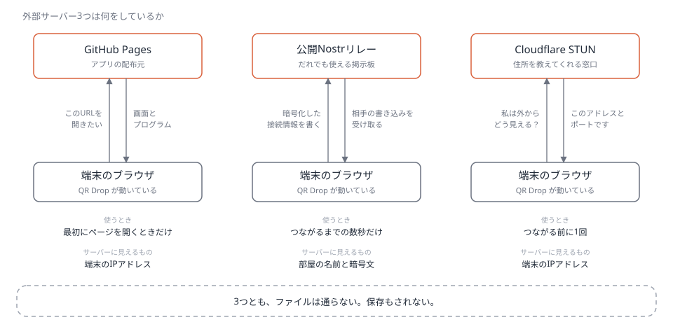
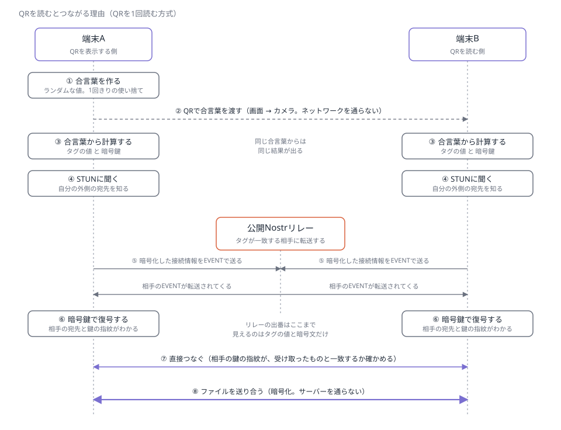
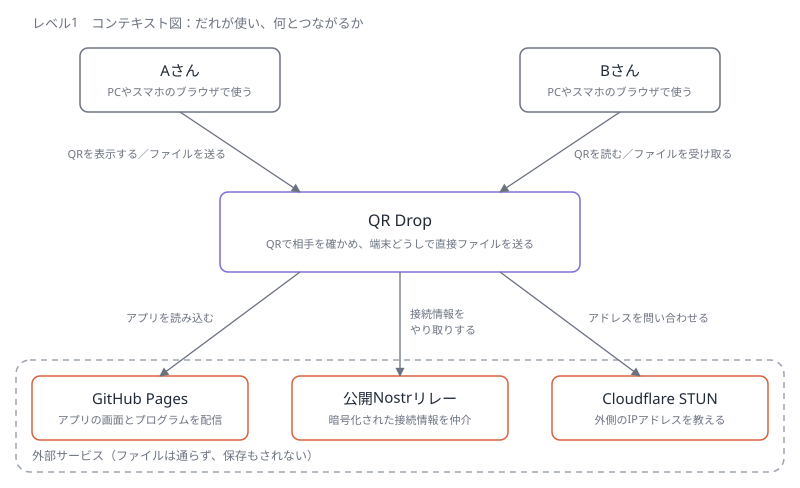
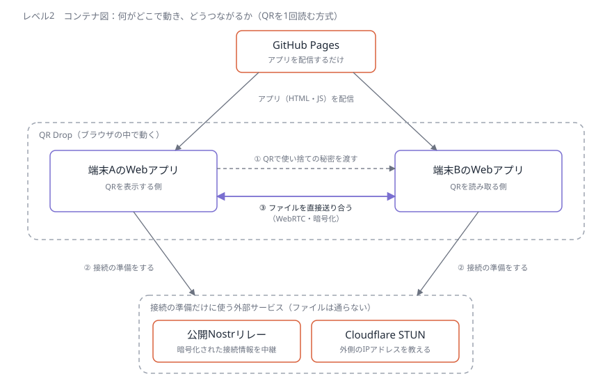
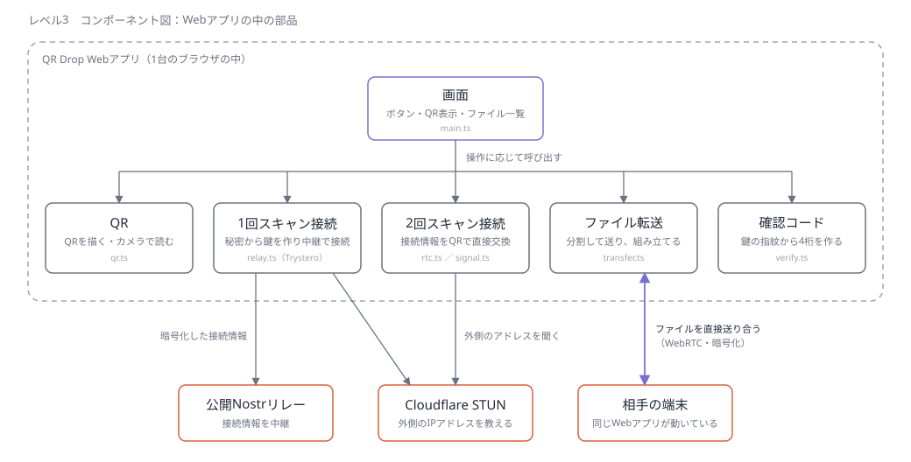

# QR Drop

QRコードを見せ合って、端末どうしで直接ファイルを送る Web アプリです。

- ログイン不要
- ファイルは WebRTC で端末間を直接流れ、サーバーには保存されません
- 自前のサーバーはなく、静的ファイルだけで動きます（GitHub Pages で配信）
- 端末には何も保存しません

## 使い方

### ふつうの使い方（QR を1回読む）

1. 片方の端末で「QRを表示する」を押す
2. もう片方のスマホのカメラ（標準のカメラアプリでよい）でその QR を読み、開いたページで待つ
3. つながったら、どちらからでもファイルを送れる

QR を使えない場合は、「QRを使えないとき」に出る URL を相手の端末で開きます。

### 中継なしでつなぐ（QR を2回読む）

1. 片方で「中継なしでつなぐ」、もう片方で「QRを読み取る」を押す
2. 読み取った側に応答の QR が出るので、最初の端末のカメラで読む

外部のサーバーを一切使わずにつなぎたいとき、または中継サーバーが使えないときの方法です。

## 仕組み

### QR を1回読む方式

- QR には使い捨ての秘密（128 ビット）を `#` 以降に入れた URL だけを載せます。`#` 以降はどのサーバーにも送られません
- 接続情報の交換は公開の Nostr リレーに任せます（[Trystero](https://github.com/dmotz/trystero) を使用）。接続情報は秘密から作った鍵で暗号化するので、リレーは中身を読めず、秘密を知らない端末は参加できません
- リレーを通るのは接続情報だけで、ファイルは通りません
- 相手は最初につながった1台だけです

### QR を2回読む方式

- QR に ICE の ufrag / pwd、DTLS 証明書のフィンガープリント、候補アドレスを載せ、受け取った側で SDP を組み立て直します（`src/signal.ts`）
- 相手の画面を直接読むことが認証を兼ねます

### 共通

- 接続後、両方の画面に4桁の確認コードを表示します。両端末の DTLS フィンガープリントから作るので、同じ数字なら間に第三者はいません
- 別ネットワーク間の接続用に Cloudflare の公開 STUN（`stun.cloudflare.com:3478`）を使います。STUN が知るのは IP アドレスだけです
- TURN は使いません。ネットワークによっては直接つながらないことがあります

## 仕組みの図

### 外部サーバー3つの役割



### QR を読むとつながる理由



## 構成図（C4モデル）

### レベル1　コンテキスト図



### レベル2　コンテナ図



### レベル3　コンポーネント図



## 制約

- 受信したファイルはいったんメモリに溜めるので、数 GB のファイルは端末によっては受け取れません
- QR を1回読む方式は他者が運営する公開リレーに依存するので、つながるまでに時間がかかったり、つながらなかったりすることがあります
- ページを閉じたり、スマホで画面をロックしたりすると接続が切れます

## 開発

```bash
bun install
bun run dev      # 開発サーバー
bun test         # テスト
bun run build    # dist/ に出力
```
